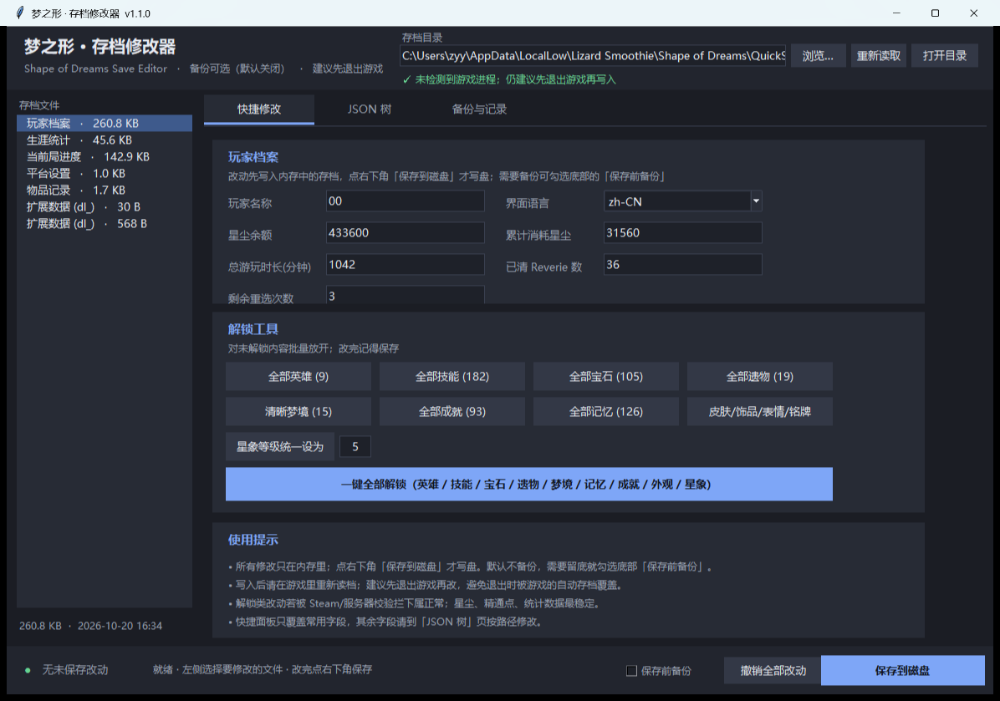

# 梦之形 · 存档修改器

《Shape of Dreams / 梦之形》的图形化存档修改器，Python + tkinter 编写，可打包成单文件 exe。



## 功能

| 页签 | 内容 |
|---|---|
| **快捷修改** | 玩家名、界面语言、星尘余额、累计消耗、游玩时长、已清 Reverie、剩余重选；一键解锁英雄 / 技能 / 宝石 / 遗物 / 清晰梦境 / 成就 / 记忆（旅人故事） / 皮肤饰品表情 / 星象等级 |
| **生涯统计** | 精通等级、精通点、胜负场次等；「既视感（DeJaVu）」一键把每个记忆/精粹的胜场补到 5 |
| **JSON 树** | 整份存档展开成可点选的树，任意字段都能改，带搜索 |
| **备份与记录** | 改动预览（原值 → 新值）、备份列表、一键回滚、手动备份当前文件 |

## 特点

- **未改动字段逐字节不变**：内部用 `Decimal` 保留数字原始文本，并对当前版本 8 个存档文件做过「读入 → 写出」字节级校验。
- **保存前校验**：序列化结果会重新解析一遍，失败就不写；先写临时文件再原子替换。
- **备份可选**：底部「保存前备份」默认关闭，需要留底时勾选一次即可。
- **误输入保护**：数字框输入非法值变红提示；值没变化不产生改动。
- **游戏运行提醒**：检测到 `Shape of Dreams.exe` 会提示先退出游戏，避免被游戏自动存档覆盖。

## 使用

1. 从 [Releases](../../releases) 下载 `ShapeOfDreamsSaveEditor.exe`（或按下面的「从源码运行」）。
2. **先退出游戏**。
3. 双击 exe，程序会自动定位到
   `C:\Users\<用户名>\AppData\LocalLow\Lizard Smoothie\Shape of Dreams\QuickSave`；
   不对就点「浏览…」。
4. 左侧选文件（一般选「玩家档案」），右侧改数值。
5. 点右下角 **「保存到磁盘」**，然后重启游戏读档。

快捷键：`Ctrl+S` 保存。

## 关于「既视感里的记忆/精粹」

游戏里的既视感条目要满足两个条件才可用：

1. **持有**该记忆/精粹（存档 `status = 2`）；
2. **用它到达过纯白之梦**（`r_stats` 中该条目的 `wins > 0`）。

所以流程是：

1. 「玩家档案」→ 点「全部记忆 (126)」等解锁按钮；
2. 左侧切到「生涯统计」→ 点「全部记忆 / 精粹胜场设为 5」；
3. 保存，重启游戏。

两个文件都改完，既视感界面才会全亮。

## 从源码运行

```bash
git clone https://github.com/shy-zhong/Shape-of-Dreams-Save-Edit.git
cd Shape-of-Dreams-Save-Edit
python -m venv .venv
.venv\Scripts\activate
python -m sod_save_editor          # 需要先把 src 加入 PYTHONPATH
```

或者直接用源码目录启动：

```bat
python -m venv .venv
.venv\Scripts\activate
set PYTHONPATH=src
python -m sod_save_editor
```

## 构建 exe

```bat
python -m venv .venv
.venv\Scripts\activate
pip install -r requirements.txt
python tools\build_exe.py
```

产物在 `dist\ShapeOfDreamsSaveEditor.exe`。

## 测试

```bat
.venv\Scripts\activate
python -m unittest discover -s tests -v
```

测试覆盖：JSON 字节级往返、字段解析、改动对比、各类解锁、既视感统计、备份创建/恢复。

## 目录结构

```
├─ src/sod_save_editor/
│  ├─ __main__.py        入口（python -m sod_save_editor）
│  ├─ app.py             主窗口与应用状态
│  ├─ core/
│  │  ├─ jsonio.py       Decimal 保真 JSON 读写
│  │  ├─ edits.py        改动对比
│  │  ├─ documents.py    存档文件与文档对象
│  │  ├─ unlocks.py      各类解锁 / 既视感统计（纯函数）
│  │  ├─ backups.py      备份创建与恢复
│  │  └─ system.py       进程检测、窗口截图
│  └─ ui/
│     ├─ theme.py        配色与字体
│     ├─ widgets.py      深色控件工厂
│     └─ pages/
│        ├─ quick.py     快捷修改页
│        ├─ tree.py      JSON 树页
│        └─ backup.py    备份与记录页
├─ tests/test_core.py    单元测试
├─ tools/build_exe.py    打包脚本
└─ tools/run.py          PyInstaller 入口
```

## 注意

- 修改前请自行备份存档；勾选「保存前备份」或复制整个 `QuickSave` 文件夹。
- 开启 Steam 云同步时，游戏启动可能用云端版本覆盖本地文件。
- `r_items.json` 是带 SteamID 签名的加密数据，不要手改。
- 本工具只读写 `QuickSave` 下的 `r_*.json`，不修改游戏本体。

## License

[MIT](LICENSE)
